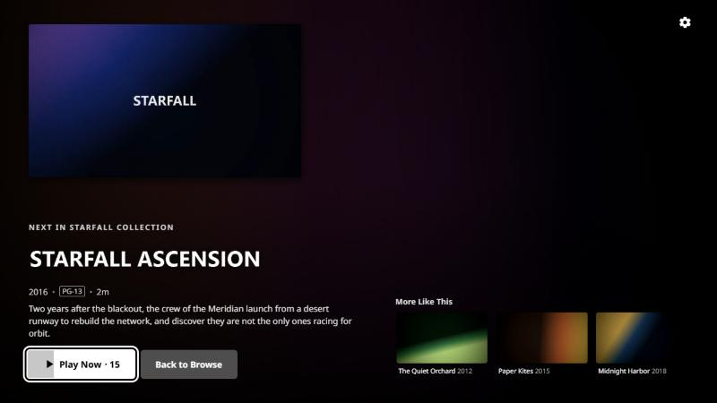
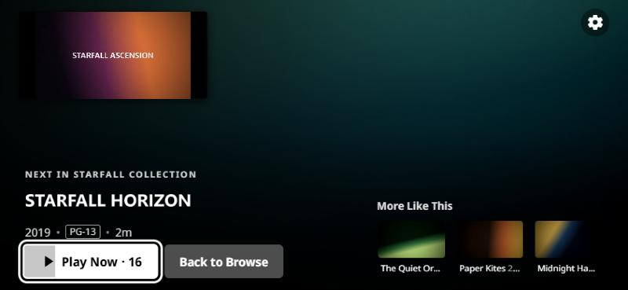
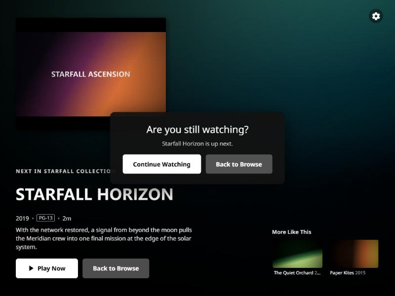
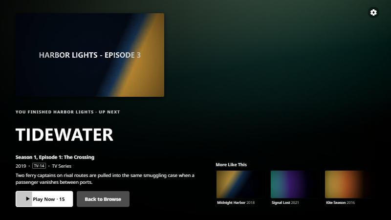

<p align="center">
  
</p>

<p align="center">
  <a href="https://github.com/PraiseGodForAllEternity/jellyfin-plugin-upnext/releases/latest"></a>
$B
  
  <a href="https://github.com/PraiseGodForAllEternity/jellyfin-plugin-upnext/actions/workflows/build.yml"></a>
  <a href="LICENSE"></a>
</p>

# Up Next for Jellyfin

Netflix-style "Up Next" for movies, and for when a TV show runs out of episodes. When a movie reaches its credits, the video shrinks to the top-left corner and a card counts down to the next film.



- **Trilogies and film series:** the next movie in the series, in release order (*Fellowship* → *Two Towers* → *Return of the King*). Works out of the box; see [how it knows](#how-it-knows-what-comes-next).
- **Everything else:** a similar movie you haven't watched yet, matched on genre, studio, era and rating.
- **On the card:** Play Now, Back to Browse, and a few other suggestions. Click the small video to go back to fullscreen and watch the credits.
- **Per user:** everyone can turn autoplay on or off and pick their countdown length.
- **"Are you still watching?"** After 3 movies autoplay in a row with nobody touching anything, Up Next asks before starting another, so a marathon doesn't run all night after everyone falls asleep.
- **Series-aware suggestions:** if a suggestion is part of a series, you get the first part you haven't seen, never the middle of a trilogy.

### TV shows

Between episodes, nothing changes: Jellyfin's own next-episode autoplay keeps working as usual. Up Next only steps in on the **last episode** of a show:

- **The show has ended:** the card counts down to a similar show you haven't started, from Season 1, Episode 1. Movies that share a collection with the show are suggested too.
- **The show is still airing** (you're on the newest episode): the card says *"You're all caught up"* and offers suggestions, but never starts anything on its own.

A show counts as ended only when its metadata says so. Unknown status is treated as still airing.

| Settings for each user | On a phone |
|---|---|
|  |  |
| **Are you still watching?** | **After a series finale** |
|  |  |

<sub>Screenshots use made-up demo movies and shows.</sub>

## How it knows what comes next

When a movie ends, Up Next looks for the film series it belongs to, in this order:

1. **Jellyfin collections** it's in, whether you made them yourself or Jellyfin made them because the library's *Automatically add to collection* option is on. Your own collections win, so you can fix an odd series by grouping it yourself.
2. **The TMDb film series** stored in the movie's metadata. Jellyfin records this for every movie it identifies, even when that option is off (and it's off by default), so a library with no collections at all still works.

The films are then sorted by release date, and the next one you haven't reached plays. For example, with Resident Evil (2002) through The Final Chapter (2016), each film leads to the next. If a movie is in more than one series, the smallest one wins: a trilogy beats a 30-film franchise collection.

If the movie isn't part of a series, or it's the last one, Up Next picks a similar movie you haven't watched. If that pick is part of a series, it starts from the first part you haven't seen.

## Requirements

- Jellyfin **10.11** or **12**. The catalog gives each server the right build automatically: version numbers ending in **.12** (like 1.5.0.12) are the Jellyfin 12 builds.
- [Intro Skipper](https://github.com/intro-skipper/intro-skipper), recommended, so Up Next knows exactly when the credits start. Make sure its credits detection is on and has finished analyzing your library: if Jellyfin shows a "Skip credits" button, it's working. Without it, Up Next uses a chapter named like "End Credits" if the file has one, and otherwise shows the card a set time before the end (3 minutes by default), which can be late for movies with long credits.

## Install

1. In Jellyfin, open **Dashboard → Plugins → Repositories** (on some versions it's under **Catalog → ⚙**) and add:

   ```
   https://raw.githubusercontent.com/PraiseGodForAllEternity/jellyfin-plugin-upnext/main/manifest.json
   ```

2. Go to **Catalog**, find **Up Next**, and install it.
3. Restart Jellyfin.
4. Reload the Jellyfin app or browser tab so it picks up the Up Next screen.

## Which apps get what

| App | What happens |
|---|---|
| Web browsers, Jellyfin Media Player (desktop) | Full Up Next screen |
| Jellyfin Android and iOS apps | Full Up Next screen. If the Android app is set to use its native player, you get autoplay only. |
| LG webOS TVs | Full Up Next screen (the app loads the web player from your server) |
| Samsung Tizen TVs | Depends on how the app was installed. If it bundles its own copy of the web player, autoplay only. |
| **Roku** | **Not supported.** The Jellyfin Roku app doesn't accept remote commands from the server, so nothing can start the next movie on it. Workaround: turn on *Automatically add to collection* for your movie library, then play a collection from its first film; the Roku app plays the films in order on its own. |
| Android TV, Fire TV, Google TV, Swiftfin, others | Autoplay only: when a movie ends, the server starts the next one after a short delay. This only works if the app accepts remote "play" commands. |

The Up Next screen runs inside Jellyfin's web player, so apps with their own native player can't show it. For those, the server starts the next movie itself, when the app lets it. Roku support depends on the Roku app adding remote control ([jellyfin-roku#1138](https://github.com/jellyfin/jellyfin-roku/issues/1138)); if it does, autoplay will start working there without any change to Up Next.

## Settings

**Admins:** Dashboard → Plugins → Up Next

- Default mode: autoplay, show Up Next without autoplay, or off
- Countdown length (default 30 seconds)
- How early to show Up Next when no credits were detected
- How many movies can autoplay in a row before asking "Are you still watching?" (default 3, 0 = never ask)
- How many other suggestions to show
- **Check a movie:** search for any movie or episode to see which series Up Next found, the play order, what plays next, and when the card will appear (and why)
- Skip already-watched movies when continuing a collection
- Turn the web screen or the server-side autoplay on or off

**Users:** Settings → **Up Next** (in the user menu), or the ⚙ button on the Up Next card.

## Remote / keyboard

Arrow keys move between buttons, **OK / Enter** picks one, and **Back / Esc** goes back to fullscreen to watch the credits.

## How it works

- The plugin adds a small script to Jellyfin's web page as it's served. Nothing on disk is changed, so it works with read-only installs (Ubuntu packages, Docker). If the [File Transformation](https://github.com/IAmParadox27/jellyfin-plugin-file-transformation) plugin is installed, Up Next uses it as well.
- The script watches the web player. When it reaches the credits start reported by Intro Skipper, it shrinks the video and shows the card.
- Starting the next movie goes through Jellyfin's own remote-control command, so the player handles it like any other "play" request.
- For apps without the script, the server watches for a movie that played to the end and sends the same "play" command to that app.

## Testing status

Up Next is new. Here's what has actually been tested, and what hasn't yet. If you try it somewhere on the second list, please [open an issue](https://github.com/PraiseGodForAllEternity/jellyfin-plugin-upnext/issues) and say how it went.

**Tested**

- Jellyfin 10.11.11 on Windows (test server) and 10.11 on Ubuntu (real library)
- Jellyfin 12.4 on Windows (test server): installing from the catalog, the Up Next card, collections, countdown autoplay, Play Now, the settings page and Check a movie
- The web player in a Chromium-based browser: the shrink-to-corner card, countdown, Play Now, Back to Browse, More Like This, Watch Credits, the end screen, and keyboard navigation
- Next film from a Jellyfin collection, and from the TMDb series in a movie's metadata with no collection
- Similar-movie picks, and series-aware suggestions (a series is suggested from its first unwatched part)
- "Are you still watching?" in the web player
- TV shows: series finale → next show from Season 1, Episode 1; still airing → "all caught up"
- Credits timing from an "End Credits" chapter, and the time-before-the-end fallback
- User settings, the admin settings page, and Check a movie
- A phone-sized screen, by resizing a desktop browser
- Server autoplay and "still watching" for other apps, using a simulated remote-controllable app

**Not tested yet**

- Credits timing from **Intro Skipper's** detected credits (the code is in place, but no test library had Intro Skipper results)
- Real **Android TV, Fire TV, Google TV and Swiftfin** devices (only a simulated app)
- The **Jellyfin Android and iOS apps** on a real phone, and touch controls
- **LG webOS and Samsung Tizen** TVs, including their remotes and older built-in browsers
- **Jellyfin Media Player** (desktop app), **Firefox** and **Safari**
- Playback that's being **transcoded**, where the card timing relies on the server's position reports
- Servers behind a **reverse proxy or with a base URL** (e.g. `example.com/jellyfin`)
- The **File Transformation** plugin integration
- **Large libraries**, multiple people watching at once, and users with **parental controls** or limited library access (handled in the code, not tested with real accounts)
- Shows with **multiple seasons, specials or missing episodes** (tested with one-season shows)
- On **Jellyfin 12**: a real library, upgrading a server from 10.11 to 12 with Up Next installed, the TV-show cards (only checked through the API), and server autoplay for other apps
- Jellyfin versions older than 10.11

**Known not to work**

- **Roku:** the Jellyfin Roku app doesn't accept remote commands. See [Which apps get what](#which-apps-get-what).

## Building

Requires the .NET 10 SDK (it builds both the .NET 9 and .NET 10 versions).

```powershell
./build.ps1 -Version 1.5.0.0 -Changelog "What changed"
```

This builds `dist/up-next_1.5.0.0.zip` for Jellyfin 10.11 and `dist/up-next_1.5.0.12.zip` for Jellyfin 12, and adds both to `manifest.json`. To release them:

```powershell
gh release create v1.5.0.0 dist/up-next_1.5.0.0.zip dist/up-next_1.5.0.12.zip --title "Up Next 1.5.0.0" --notes "What changed"
git add manifest.json
git commit -m "Release 1.5.0.0"
git push
```

To build just one version while working on it: `dotnet build -p:JellyfinTarget=12` (or `10.11`, the default).

## License

GPL-3.0. See [LICENSE](LICENSE).
