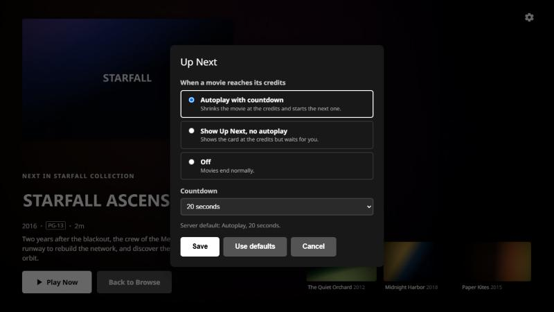

<p align="center">
  
</p>

<p align="center">
  <a href="https://github.com/PraiseGodForAllEternity/jellyfin-plugin-upnext/releases/latest"></a>
  
  <a href="https://github.com/PraiseGodForAllEternity/jellyfin-plugin-upnext/actions/workflows/build.yml"></a>
  <a href="LICENSE"></a>
</p>

# Up Next for Jellyfin

Netflix-style "Up Next" for movies. When a movie reaches its credits, the video shrinks to the top-left corner and a card counts down to the next film.


- **Trilogies and collections:** the next movie in the collection, in release order (*Fellowship* → *Two Towers* → *Return of the King*).
- **Everything else:** a similar movie you haven't watched yet, matched on genre, studio, era and rating.
- **On the card:** Play Now, Back to Browse, and a few other suggestions. Click the small video to go back to fullscreen and watch the credits.
- **Per user:** everyone can turn autoplay on or off and pick their countdown length.
- **"Are you still watching?"** After 3 movies autoplay in a row with nobody touching anything, Up Next asks before starting another, so a marathon doesn't run all night after everyone falls asleep.
- **Series-aware suggestions:** if a suggestion is part of a series, you get the first part you haven't seen, never the middle of a trilogy.

| Settings for each user | On a phone |
|---|---|
|  |  |
| **Are you still watching?** | |
|  | |

<sub>Screenshots use made-up demo movies.</sub>

## Requirements

- Jellyfin **10.11**
- [Intro Skipper](https://github.com/intro-skipper/intro-skipper), recommended, so Up Next knows exactly when the credits start. Without it, the card shows up a set number of seconds before the end (3 minutes by default).

## Install

1. In Jellyfin, open **Dashboard → Plugins → Repositories** (on some versions it's under **Catalog → ⚙**) and add:

   ```
   https://raw.githubusercontent.com/PraiseGodForAllEternity/jellyfin-plugin-upnext/main/manifest.json
   ```

2. Go to **Catalog**, find **Up Next**, and install it.
3. Restart Jellyfin.
4. Reload the Jellyfin app or browser tab so it picks up the Up Next screen.

## Which apps get what

| App | What happens |
|---|---|
| Web browsers, Jellyfin Media Player (desktop) | Full Up Next screen |
| Jellyfin Android and iOS apps | Full Up Next screen. If the Android app is set to use its native player, you get autoplay only. |
| LG webOS TVs | Full Up Next screen (the app loads the web player from your server) |
| Samsung Tizen TVs | Depends on how the app was installed. If it bundles its own copy of the web player, autoplay only. |
| Roku, Android TV, Fire TV, Google TV, Swiftfin, others | Autoplay only: when a movie ends, the server starts the next one after a short delay. This only works if the app accepts remote "play" commands. |

The Up Next screen runs inside Jellyfin's web player, so apps with their own native player can't show it. For those, the server starts the next movie itself.

## Settings

**Admins:** Dashboard → Plugins → Up Next

- Default mode: autoplay, show Up Next without autoplay, or off
- Countdown length (default 20 seconds)
- How early to show Up Next when no credits were detected
- How many movies can autoplay in a row before asking "Are you still watching?" (default 3, 0 = never ask)
- How many other suggestions to show
- Skip already-watched movies when continuing a collection
- Turn the web screen or the server-side autoplay on or off

**Users:** Settings → **Up Next** (in the user menu), or the ⚙ button on the Up Next card.

## Remote / keyboard

Arrow keys move between buttons, **OK / Enter** picks one, and **Back / Esc** goes back to fullscreen to watch the credits.

## How it works

- The plugin adds a small script to Jellyfin's web page as it's served. Nothing on disk is changed, so it works with read-only installs (Ubuntu packages, Docker). If the [File Transformation](https://github.com/IAmParadox27/jellyfin-plugin-file-transformation) plugin is installed, Up Next uses it as well.
- The script watches the web player. When it reaches the credits start reported by Intro Skipper, it shrinks the video and shows the card.
- Starting the next movie goes through Jellyfin's own remote-control command, so the player handles it like any other "play" request.
- For apps without the script, the server watches for a movie that played to the end and sends the same "play" command to that app.

## Building

Requires the .NET 9 SDK or newer.

```powershell
./build.ps1 -Version 1.0.0.0 -Changelog "First release"
```

This builds `dist/up-next_1.0.0.0.zip` and adds the version to `manifest.json`. To release it:

```powershell
gh release create v1.0.0.0 dist/up-next_1.0.0.0.zip --title "Up Next 1.0.0.0" --notes "First release"
git add manifest.json
git commit -m "Release 1.0.0.0"
git push
```

## License

GPL-3.0. See [LICENSE](LICENSE).
